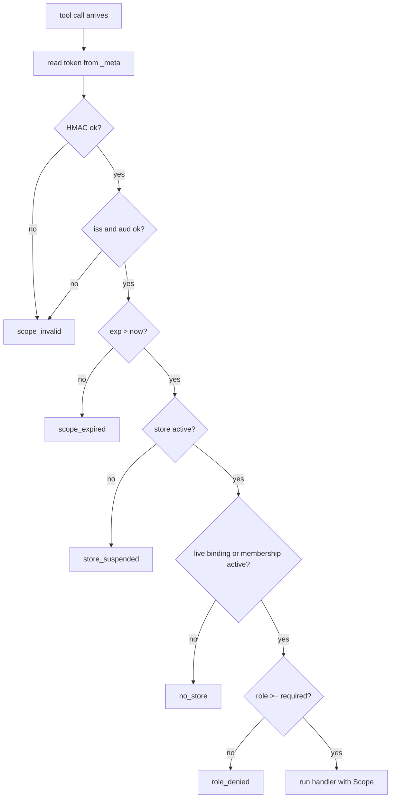
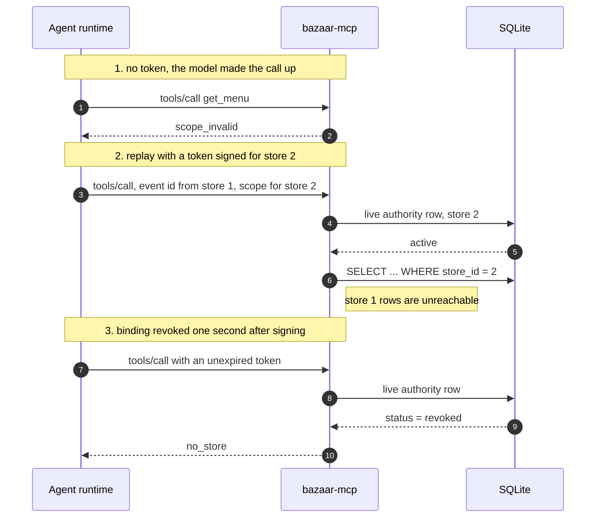

# Authorization at the channel hop

Status: proposed, 2026-11-20

## Context

Today the MCP tools trust the model. Hard rule 11 states it: the group is trusted,
the model supplies every tool argument, and ZeroClaw does not pass sender identity
to the tools. With many stores in one database and strangers sending messages,
a tool call must be bounded by something the model cannot produce.

## Decision

1. A new Go `gateway` terminates WhatsApp and Telegram. It reads the channel's own
   metadata (`chat_ref`, `sender_ref`) and resolves the caller to a store.
2. The gateway signs that result as a short-lived scope token (HMAC-SHA256, 300s).
3. `bazaar-mcp` verifies the token on every tool call and refuses on failure.
4. No tool takes a `store` argument. No tool takes a `role` argument.
5. Every SQL statement carries the store from the verified token.

### Scope token

```json
{
  "iss": "bazaar-gateway",
  "aud": "bazaar-mcp",
  "channel": "whatsapp",
  "chat_ref": "120363041234567890@g.us",
  "sender_ref": "6281234567890@s.whatsapp.net",
  "store_id": 1,
  "iat": 1795000000,
  "exp": 1795000300,
  "jti": "01J8ZC4Q7N"
}
```

The token proves **who** called. It does not prove **what they may do**. The role
and the binding status are re-read from the database on each call, so revoking a
binding takes effect on the next message instead of after the token expires.

```go
// VerifyScope checks signature and expiry, then loads the live authority row.
func VerifyScope(token string, now int64, secret []byte, q *db.Queries) (Scope, error)

type Scope struct {
	StoreID   int64  // from token, cross-checked with the authority row
	Channel   string
	ChatRef   string
	AccountID *int64 // set for a DM principal
	Role      string // from the authority row, not the token
}
```

Checks, in order. Each failure returns its own code so tests can assert on it.

| # | Check | Error code |
|---|---|---|
| 1 | HMAC verified | `scope_invalid` |
| 2 | `iss`, `aud` match | `scope_invalid` |
| 3 | `exp` > now, `iat` <= now | `scope_expired` |
| 4 | store exists and `status = 'active'` | `store_suspended` |
| 5 | live binding or membership row exists with `status = 'active'` | `no_store` |
| 6 | live row role >= tool's required role | `role_denied` |

Token transport: MCP request `_meta` (`params._meta["id.bazaar/scope"]`), or an
HTTP header when the backend runs on `streamable-http`. The gateway sets it. The
model never sees it, and cannot overwrite it, because it is outside the tool
arguments.

## Diagrams

Verification runs in a fixed order. The first failing check returns its code and
no handler runs.



Three failures worth testing by name.



## Example

A staff member posts an order in a bound group.

```
WhatsApp chat 120363041234567890@g.us → store_groups → store KPKM, role staff
sender 6281234567890@s.whatsapp.net   → account_channels → account 12
```

Gateway resolves, signs, and forwards. The tool call the model makes carries no
store:

```json
{ "method": "tools/call",
  "params": { "name": "get_menu",
              "arguments": { "event_id": "BAZAR-2026-11-15" },
              "_meta": { "id.bazaar/scope": "<token>" } } }
```

The backend runs `WHERE store_id = 1` because the token said so, not because
anything in `arguments` did. The same call replayed with a token for store
`WARTEG` reads that store's menu instead, which is why the test suite signs a
token for store A and calls with store B's event id.

Failure example. The admin revokes the group binding at 12:00:00. A message at
12:00:01 still presents a token signed at 11:59:50. Check 5 fails, the reply is
"Grup ini tidak terhubung ke store mana pun", and no row is written.

## Alternatives

- Patch ZeroClaw to forward sender identity into MCP args: smallest diff, keeps
  authority inside the agent runtime, and pins us to a fork.
- One bot, one database, one MCP process per store: real isolation, N QR pairings
  and N backups on a 1.9 GiB VPS that also runs PM-WA.
- `store` as a tool argument validated server-side: proves the store exists, not
  that the caller belongs to it.

## Consequences

- HTTP or stdio: the backend must be able to read the scope per call, so a
  long-lived stdio session needs `_meta` rather than a process-level env var.
- The gateway holds the signing key. Rotating it invalidates every live token.
- One indexed lookup per tool call for the authority row. Fine with
  `SetMaxOpenConns(1)`; measure before optimizing.
- `mcpserver` gets one wrapper around `mcp.AddTool` that verifies the scope,
  applies the role matrix, and puts the `Scope` into the handler's
  `context.Context`. Every handler already receives `*mcp.CallToolRequest` and
  currently discards it (`_`); the token is read from `req.Params.Meta`, so the
  17 signatures do not change.
- ZeroClaw is no longer the authorizer. Whether it stays the agent runtime is out
  of scope for this ADR.
