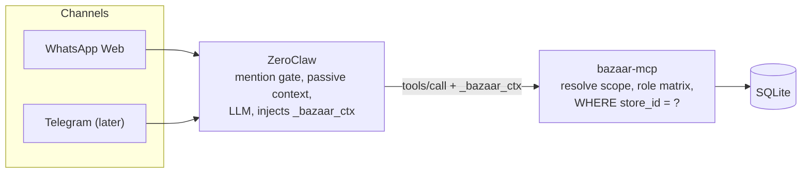
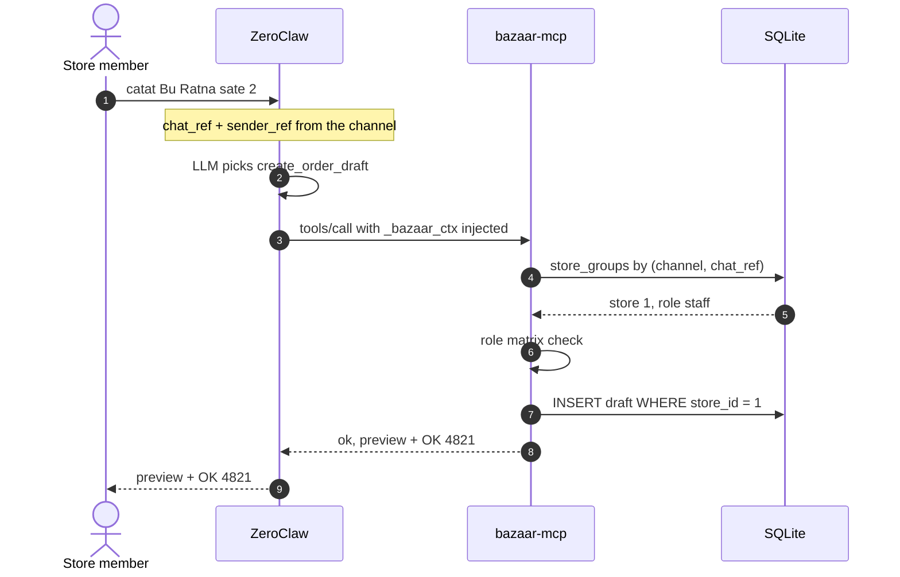
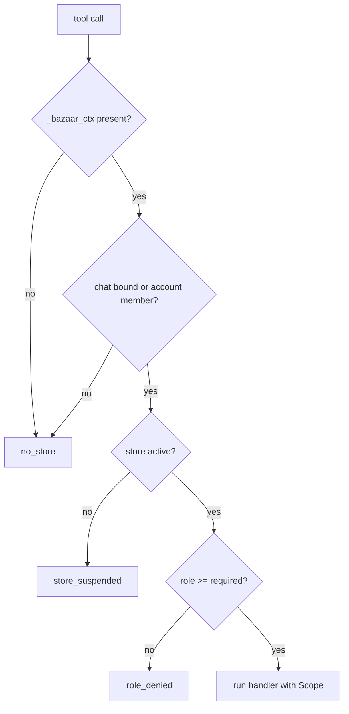

# Identity comes from the runtime process

Status: accepted, 2026-11-21. Replaces the gateway variant, which assumed we
would not keep ZeroClaw.

## Context

The MCP tools trust the model. Hard rule 11 states it: the group is trusted, the
model supplies every tool argument, and ZeroClaw does not pass sender identity to
the tools. With many stores in one database and strangers sending messages, a
tool call must be bounded by something the model cannot produce.

ZeroClaw stays. It is the only component holding the channel sessions, and
replacing it means replacing WhatsApp and, later, Telegram. So the identity has to
come from ZeroClaw, not from a new gateway in front of it.

## Decision

1. ZeroClaw knows, for every message, the channel, the chat and the sender. For
   WhatsApp and Telegram it already parses those fields.
2. Before every MCP tool call, ZeroClaw injects them as one reserved field into
   the arguments: `_bazaar_ctx = {channel, chat_ref, sender_ref}`.
3. The field is written after the model's arguments are parsed, so the model can
   neither supply it nor overwrite it.
4. `bazaar-mcp` resolves that triple to a store and a role from `store_groups`
   and `account_channels` + `store_members`.
5. No tool takes a `store` or a `role` argument. Every query carries
   `WHERE store_id = ?` from the resolved scope.
6. Nothing resolves, nothing happens. A missing field, an unknown chat or a
   revoked binding all deny with `no_store`. There is no fallback to the active
   store.

The trust anchor is the parent process over stdio. There is no network hop, so
there is no token to sign and no key to rotate. If someone can run a different
parent process on that host, they can also read the database directly; nothing is
lost.

## Patch shape

Three touch points in ZeroClaw, all already carrying the values:

| Step | Where | Change |
|---|---|---|
| turn preamble already has `reply_target`, `sender`, `message_id` | `crates/zeroclaw-channels/src/orchestrator/mod.rs:2438` | nothing, it proves the values are in scope |
| tool dispatch | `crates/zeroclaw-tools/src/mcp_tool.rs:96` | merge `_bazaar_ctx` into `args` before dispatch |
| request serialization | `crates/zeroclaw-tools/src/mcp_client.rs:745`, `:870` | pass the field through untouched |
| channel identity | `telegram.rs:241,244`, `whatsapp_web.rs` | already parsed |

Plumbing the triple from the orchestrator turn to the dispatch site is the only
real work. `_meta` is not implemented in the MCP client today; a reserved
argument is the smaller change and needs no protocol work.

## Diagrams





Failure paths:



## Example

The model asks for the menu. What reaches the backend:

```json
{ "name": "get_menu",
  "arguments": {
    "event_id": "BAZAR-2026-11-15",
    "_bazaar_ctx": { "channel": "whatsapp",
                     "chat_ref": "120363041234567890@g.us",
                     "sender_ref": "6281234567890@s.whatsapp.net" } } }
```

Resolution:

```sql
-- group chat
SELECT store_id, role FROM store_groups
 WHERE channel = ? AND chat_ref = ? AND status = 'active';

-- direct message
SELECT m.store_id, m.role
  FROM account_channels ac JOIN store_members m ON m.account_id = ac.account_id
 WHERE ac.channel = ? AND ac.ref = ? AND ac.status = 'active' AND m.status = 'active';
```

The event id above belongs to store 1, so the query runs as
`SELECT ... WHERE store_id = 1 AND event_id = ...`. A model that pastes another
store's event id gets `not_found`, not data.

## Alternatives

- **A gateway in front with a signed scope token.** Only necessary when the
  boundary crosses a network and a process we do not control. Here the parent
  process is ours. Costs a service, a key, a hop, and more memory.
- **One ZeroClaw + one database per store.** Real isolation, no patch. Costs one
  paired session, one process and one backup per store, and DMs become ambiguous
  because every instance answers.
- **`store` as a tool argument validated server-side.** Proves the store exists,
  not that the caller belongs to it.

## Tests

Unit, in `db_test` and `mcpserver`.

| Case | Setup | Expect |
|---|---|---|
| group bound | active binding for the chat | scope store 1, role staff |
| DM member | active membership for the sender | scope store 1, role from the row |
| unknown chat | no binding, no member | `no_store` |
| revoked binding | row `revoked` | `no_store` |
| suspended store | `stores.status = 'suspended'` | `store_suspended` |
| low role | staff scope on an organizer tool | `role_denied`, handler not called |
| field missing | call without `_bazaar_ctx` | `no_store`, and a test asserts all 17 tools do it |
| field malformed | `_bazaar_ctx` not an object | `no_store` |
| cross-store event | store 1 scope, event of store 2 | `not_found`, zero rows |

E2E: E2E-A5, E2E-A6, E2E-O17, E2E-A7, E2E-X8, E2E-A9 in
[`docs/testing/e2e-whatsapp.md`](../testing/e2e-whatsapp.md).

## Consequences

- One fork patch, re-applied with the PM-WA filter after every ZeroClaw update.
  Its failure mode is deny, not leak: a lost patch stops the bot.
- No new process, no new port, no key. Memory and operations stay as they are.
- Channel coverage is what ZeroClaw compiles in. Telegram exists behind
  `channel-telegram` and needs a rebuild, which is a separate piece of work.
- The role matrix lives in `mcpserver`: one wrapper around `mcp.AddTool` resolves
  the scope, applies the minimum role, and puts the `Scope` in the handler's
  context. The 17 handler signatures stay as they are.
- Prompt injection can still ask for another store. It cannot name one, because
  the name is not an argument.
