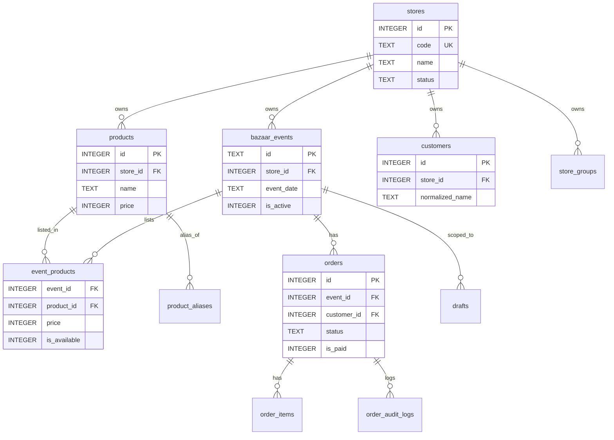
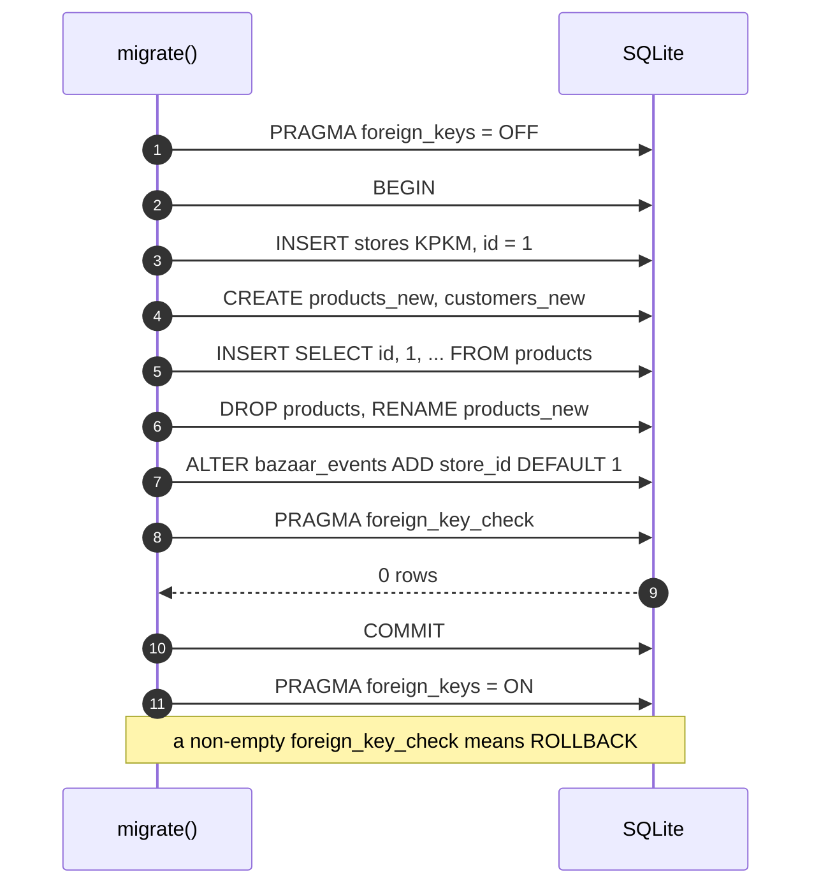

# A store owns its events, menu and customers

Status: proposed, 2026-11-20

## Context

The catalog is global and customers are global. Both make sense for one business
and both collide across stores: `products.name UNIQUE` and
`customers.normalized_name UNIQUE` are one-namespace keys. `find_customer` also
returns an order count, so a shared customer row leaks one store's numbers into
another store's chat.

## Decision

Add `store_id` to `bazaar_events`, `products`, `customers`. Leave orders, order
items, drafts, audit logs alone; they reach their store through their parent.

```sql
CREATE TABLE stores (
    id         INTEGER PRIMARY KEY AUTOINCREMENT,
    code       TEXT NOT NULL UNIQUE,      -- what people type: KPKM
    name       TEXT NOT NULL,
    status     TEXT NOT NULL DEFAULT 'active'
               CHECK(status IN ('active','suspended')),
    created_at INTEGER NOT NULL
);

-- per store, not global
CREATE UNIQUE INDEX idx_product_name   ON products(store_id, name);
CREATE UNIQUE INDEX idx_product_norm   ON products(store_id, normalized_name);
CREATE UNIQUE INDEX idx_customer_norm  ON customers(store_id, normalized_name);
CREATE UNIQUE INDEX idx_one_active_event
    ON bazaar_events(store_id) WHERE is_active = 1;
```

Aliases follow their product, so an alias learned in one store never resolves in
another. `store_members` and `store_groups` carry `store_id` too; see ADR 0001 and
0004.

## Diagrams

Tables with a `store_id` column are queried with it. Tables without one reach
their store through a parent, so they cannot point at another store.



Migration order matters: create `stores`, backfill it, rebuild the constrained
tables, then add the loose columns.



## Example

Before the migration, the second store cannot add its own dish:

```sql
INSERT INTO products(name, normalized_name, category, price)
VALUES ('Sate ayam', 'sate ayam', 'Makanan', 35000);
-- SQLite error: UNIQUE constraint failed: products.name
```

After, both rows exist and nothing is shared but the name:

```sql
INSERT INTO products(store_id, name, normalized_name, category, price)
VALUES (1, 'Sate ayam', 'sate ayam', 'Makanan', 35000),   -- KPKM
       (2, 'Sate ayam', 'sate ayam', 'Makanan', 30000);   -- WARTEG
```

Every read carries the store, so `find_customer` cannot see the other business:

```go
rows, err := d.sql.QueryContext(ctx, `
    SELECT id, display_name, normalized_name
      FROM customers
     WHERE store_id = ? AND normalized_name LIKE ?`, storeID, "%susi%")
```

## Migration

`PRAGMA foreign_keys` is ON for normal connections, and SQLite refuses
`ALTER TABLE ... ADD COLUMN ... NOT NULL DEFAULT 'KPKM' REFERENCES stores(id)`
while it is on. The UNIQUE constraints also have to be replaced, and SQLite
cannot drop a constraint. So products and customers are rebuilt.

```sql
-- run inside migrate() with foreign_keys temporarily OFF on this connection
PRAGMA foreign_keys = OFF;
BEGIN;
INSERT INTO stores(code, name, created_at)
VALUES ('KPKM', 'Bazar KPKM', strftime('%s','now'));   -- id = 1

CREATE TABLE products_new (
    id INTEGER PRIMARY KEY AUTOINCREMENT,
    store_id INTEGER NOT NULL REFERENCES stores(id),
    name TEXT NOT NULL,
    normalized_name TEXT NOT NULL,
    category TEXT NOT NULL,
    price INTEGER NOT NULL CHECK(price >= 0),
    is_available INTEGER NOT NULL DEFAULT 1,
    created_at INTEGER NOT NULL,
    updated_at INTEGER NOT NULL,
    UNIQUE(store_id, name),
    UNIQUE(store_id, normalized_name)
);
INSERT INTO products_new
    SELECT id, 1, name, normalized_name, category, price,
           is_available, created_at, updated_at
      FROM products;
DROP TABLE products;
ALTER TABLE products_new RENAME TO products;
-- customers: same shape, same backfill
-- bazaar_events: plain ADD COLUMN is enough here
ALTER TABLE bazaar_events ADD COLUMN store_id INTEGER NOT NULL DEFAULT 1
    REFERENCES stores(id);
PRAGMA foreign_key_check;
COMMIT;
PRAGMA foreign_keys = ON;
```

`PRAGMA foreign_key_check` must return zero rows before the commit. Running it
after `COMMIT` is too late to roll back.

## Alternatives

- Products global, isolation only through the event: smaller diff, breaks on the
  first shared menu name, and still leaks the customer table.
- One database file per store: real isolation, N processes, N backups, and it
  contradicts ADR 0001 and 0003.

## Consequences

- `stores` uses an integer `id`, unlike `bazaar_events` whose primary key is the
  event code. A store can be renamed, and rewriting a primary key value across
  six tables is not worth the tidiness.
- Store codes stay globally unique because a code is how a store is addressed.
  Store `name` stays non-unique.
- Order items keep their `product_name` snapshot, so a later rename in the same
  store does not rewrite history.
- `menu.csv`, `make init` and `bazaar-mcp seed-menu` now take a store code.
  Re-seeding still overwrites prices for the active event only.
- Each read needs an isolation test. Cheap shape: seed two stores with the same
  product and customer names, then assert every per-store read returns only its
  own row.
