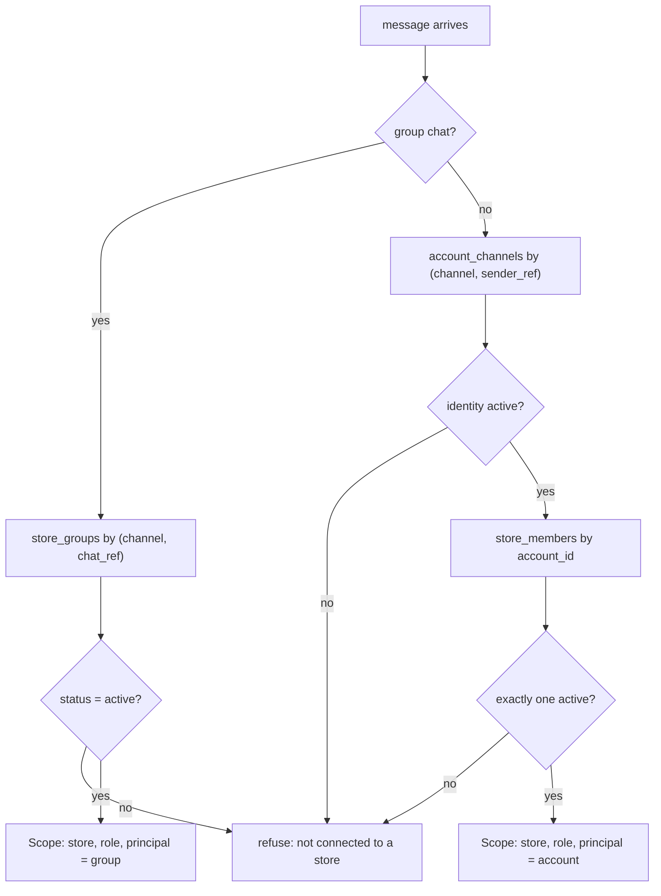
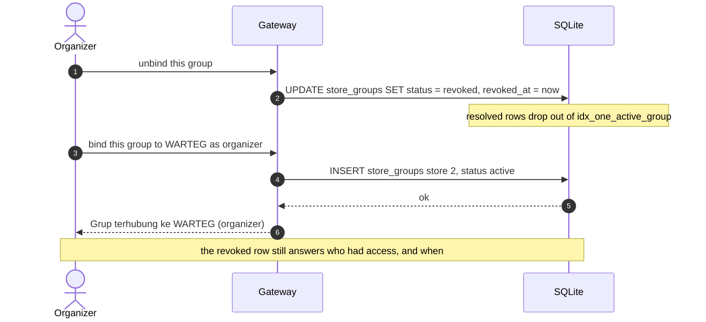

# One store per chat, one store per person

Status: proposed, 2026-11-20

## Context

Resolution in ADR 0001 must return exactly one store. Any rule that allows two
turns the answer into a question the bot has to ask in the middle of an order, and
a wrong answer writes into the wrong business.

## Decision

```sql
CREATE UNIQUE INDEX idx_one_active_group
    ON store_groups(channel, chat_ref) WHERE status = 'active';
CREATE UNIQUE INDEX idx_one_active_member
    ON store_members(account_id) WHERE status = 'active';
```

A group belongs to one store permanently. A person belongs to one store at a
time, so a second store needs a second identity on any channel.

## Diagrams

Resolution has one shape per chat type, and every path ends in a store or a
refusal. There is no fallback branch.



Moving a chat to another store is revoke then bind. The old row stays.



## Example

Binding the same chat twice fails at the index, not in application code:

```sql
INSERT INTO store_groups(store_id, channel, chat_ref, role, status, created_at)
VALUES (1, 'whatsapp', '120363041234567890@g.us', 'staff', 'active', 1795000000);

INSERT INTO store_groups(store_id, channel, chat_ref, role, status, created_at)
VALUES (2, 'whatsapp', '120363041234567890@g.us', 'staff', 'active', 1795000100);
-- SQLite error: UNIQUE constraint failed: store_groups.channel, store_groups.chat_ref
```

Moving a chat to another store works because a revoked row sits outside the
partial index:

```sql
UPDATE store_groups
   SET status = 'revoked', revoked_at = 1795000200
 WHERE channel = 'whatsapp' AND chat_ref = '120363041234567890@g.us'
   AND status = 'active';

INSERT INTO store_groups(store_id, channel, chat_ref, role, status, created_at)
VALUES (2, 'whatsapp', '120363041234567890@g.us', 'organizer', 'active', 1795000201);
```

The old row stays, so "who had access to this store, and when" is answerable.

One person with two channels is two identity rows and one membership:

```sql
-- account 12
account_channels: (whatsapp, 6281234567890@s.whatsapp.net), (telegram, 998877)
store_members:    (account_id 12, store_id 1, role staff, status active)
```

Both channels resolve to store 1 with one indexed lookup per channel. The second
row only exists after a link claim is redeemed; see ADR 0004.

## Alternatives

- Allow many stores and ask when unclear: needs a session table, a picker command,
  and a rule that the remembered store must not cross chats. It also makes the
  scope in ADR 0001 non-deterministic.
- Allow many, refuse writes without an explicit store, allow reads for all: half a
  store becomes readable from the other half.

## Tests

Unit, in `db_test`, one temp SQLite per case.

| Case | Setup | Expect |
|---|---|---|
| second binding | two active rows for the same chat | unique violation on `idx_one_active_group` |
| rebind | revoke, then insert active | succeeds, two rows total |
| second membership | two active `store_members` for one account | unique violation |
| group resolution | active binding for the chat | `Scope{store, role, principal: group}` |
| DM with no store | account with no membership | `no_store`, no fallback |
| DM with one store | one active membership | `Scope{store, role, principal: account}` |
| group and DM disagree | account in store 1, chat bound to store 2 | chat wins inside the chat, membership wins in DM |
| revoked binding | row `revoked` | `no_store` |

```go
tests := []struct{ name string; chat string; wantStore int64; wantErr bool }{
	{"bound chat", "120363...@g.us", 1, false},
	{"unbound chat", "999...@g.us", 0, true},
}
```

E2E: E2E-A5, E2E-A6, E2E-X8 in
[`docs/testing/e2e-whatsapp.md`](../testing/e2e-whatsapp.md).

## Consequences

- Resolution is one lookup with one answer. No prompt, no session, no stored
  preference.
- A person who runs two stores needs two identities. This is the first limit that
  will bite.
- Upgrade path, when it does:

  ```sql
  DROP INDEX idx_one_active_member;
  CREATE UNIQUE INDEX idx_member_per_store
      ON store_members(account_id, store_id) WHERE status = 'active';
  ```

  Plus a store picker and a per-chat default. The group index stays as it is.
- `store_members` needs `(account_id)` and the group table needs
  `(channel, chat_ref)` to make the partial indexes cheap lookups.
