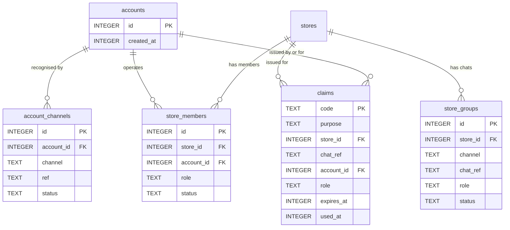
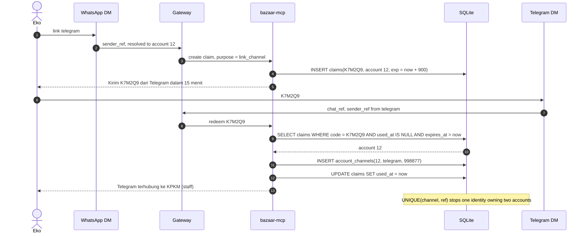

# Channel identities live in the database, in the access tables only

Status: proposed, 2026-11-20. Reverses hard rule 7.

## Context

Hard rule 7 bans WhatsApp JIDs and phone numbers in SQLite. Access is now granted
to a chat or to a person. Granting access to a group requires recording which
group, and recognising one human across two channels requires recording both
identities plus the link between them.

## Decision

Channel identities live in exactly three tables.

```sql
CREATE TABLE account_channels (
    id         INTEGER PRIMARY KEY AUTOINCREMENT,
    account_id INTEGER NOT NULL REFERENCES accounts(id),
    channel    TEXT NOT NULL CHECK(channel IN ('whatsapp','telegram')),
    ref        TEXT NOT NULL,
    status     TEXT NOT NULL DEFAULT 'active'
               CHECK(status IN ('active','revoked')),
    created_at INTEGER NOT NULL,
    UNIQUE(channel, ref)
);

CREATE TABLE store_groups (
    id         INTEGER PRIMARY KEY AUTOINCREMENT,
    store_id   INTEGER NOT NULL REFERENCES stores(id),
    channel    TEXT NOT NULL CHECK(channel IN ('whatsapp','telegram')),
    chat_ref   TEXT NOT NULL,
    role       TEXT NOT NULL CHECK(role IN ('organizer','staff')),
    status     TEXT NOT NULL DEFAULT 'pending'
               CHECK(status IN ('pending','active','revoked')),
    granted_by INTEGER NOT NULL REFERENCES accounts(id),
    created_at INTEGER NOT NULL,
    activated_at INTEGER,
    revoked_at   INTEGER
);

CREATE TABLE claims (
    code       TEXT PRIMARY KEY,          -- 6 chars, uppercase, one use
    purpose    TEXT NOT NULL
               CHECK(purpose IN ('bind_group','link_channel','invite_member')),
    store_id   INTEGER REFERENCES stores(id),
    chat_ref   TEXT,                      -- bind_group: filled at redeem
    account_id INTEGER REFERENCES accounts(id),
    role       TEXT,
    created_at INTEGER NOT NULL,
    expires_at INTEGER NOT NULL,
    used_at    INTEGER
);
```

Invariants:

1. `ref` and `chat_ref` are opaque strings. Nothing parses them, derives from
   them, or shows them.
2. No other table has a channel identity column. Orders, order items, customers,
   drafts and audit logs stay identity-free.
3. `format/` never receives a `ref`. Notifications get ids or names.
4. Log lines and error messages print row ids, never references.

## Diagrams

Only these three tables carry a channel identity. The line from `claims` is how a
chat or a second channel is attached to an account.



Linking a second channel is a claim redeemed from the other side, so neither
channel has to trust the other's word.



## Example

One person, two channels, one store:

```sql
INSERT INTO accounts(created_at) VALUES (1795000000);            -- id 12

INSERT INTO account_channels(account_id, channel, ref, created_at)
VALUES (12, 'whatsapp', '6281234567890@s.whatsapp.net', 1795000000),
       (12, 'telegram', '998877', 1795000900);                   -- linked later
```

After that, `Resolve(telegram, 998877)` returns store 1 as account 12, and the
reply is unchanged: `Store KPKM · staff`.

A review check for `format/` and every handler: no `ref` value reaches a string
that the user reads. The shape to reject:

```go
formatted += row.Ref // leaks a phone number into a chat reply
```

Deletion. Accounts are access data, not business history, so this is the one place
a hard delete is correct:

```sql
DELETE FROM account_channels WHERE account_id = ?;
DELETE FROM store_members  WHERE account_id = ?;
UPDATE store_groups SET status = 'revoked', revoked_at = ? WHERE granted_by = ?;
DELETE FROM claims      WHERE used_at IS NOT NULL AND expires_at < ?;
```

Orders keep their customer name snapshots, so history still reads correctly after
the account is gone.

## Alternatives

- Keep identities in gateway config: access cannot change from chat, no record of
  who granted what, every channel re-implements the mapping, and the backend must
  ask the gateway on every message.

## Tests

Unit, in `db_test`.

| Case | Setup | Expect |
|---|---|---|
| one account per identity | second account with the same `ref` | unique violation |
| claim unknown | redeem `ZZZZZZ` | `claim_invalid`, no row created |
| claim expired | `expires_at = now - 1` | `claim_invalid` |
| claim reused | redeem twice | second returns `claim_invalid`, one row created |
| claim wrong purpose | `link_channel` redeemed as a group bind | `claim_invalid` |
| link second channel | redeem from Telegram | one `account_channels` row, same `account_id` |
| group bind | redeem inside the chat | `store_groups` active, `claims.used_at` set |
| no ref in replies | format previews from fixtures containing a ref | the ref string never appears in output |

The last one is the rule with teeth, so it runs over every string the assistant
can send:

```go
for _, in := range fixtures {
	if strings.Contains(render(in), "6281234567890@s.whatsapp.net") {
		t.Fatalf("%s leaks a channel identity", in.name)
	}
}
```

E2E: E2E-A3, E2E-A4 in [`docs/testing/e2e-whatsapp.md`](../testing/e2e-whatsapp.md).

## Consequences

- Backups and exports contain real people's identifiers. Treat them as personal
  data, not as a database dump to attach to a chat.
- A revoked channel identity stays as a row, so access history remains readable.
- The migration for this ADR creates the tables; it does not backfill anyone, since
  every existing group lives in ZeroClaw config today.
- Replacement rule for hard rule 7: no channel identity outside the three access
  tables, and never in a reply.
