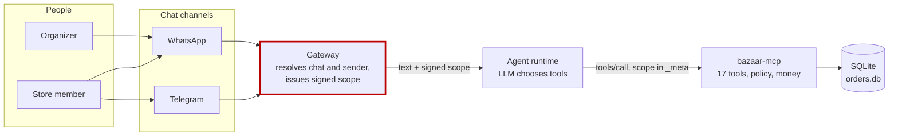
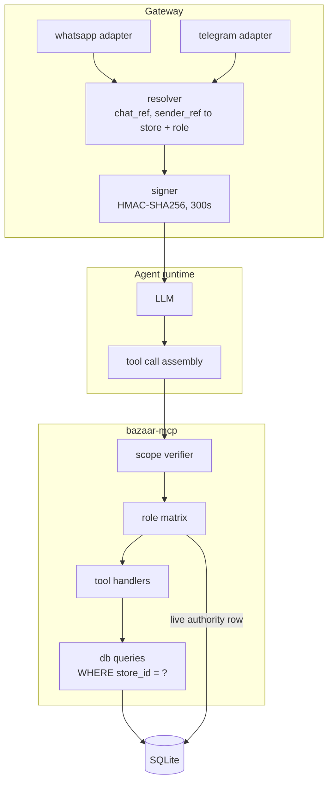
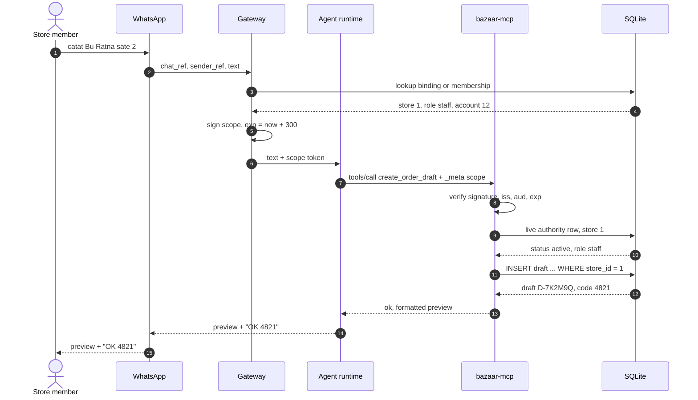

# Architecture

Status: draft, 2026-11-20. The diagrams match ADR 0001 to 0004.

## Level 1: system context

Who talks to what, and where the trust boundary sits. The gateway is the only
component allowed to say who is calling.

## Level 2: components

Inside the three components. Two channels today, and a new one is an adapter plus
nothing else.

## Level 3: where the pieces live

| Concern | Package | Notes |
|---|---|---|
| Channel authentication, scope signing | `gateway/` (new) | only writer of scope tokens |
| Scope verification, role matrix | `mcpserver/` | one wrapper around `mcp.AddTool` |
| Policy, money, drafts | `orders/` | unchanged, receives `Scope` |
| SQL, store predicates | `db/` | every statement takes a store |
| User-visible text | `format/` | never receives a channel identity |

Test scenarios that drive this system over WhatsApp Web:
[`docs/testing/e2e-whatsapp.md`](testing/e2e-whatsapp.md).

## Request path

