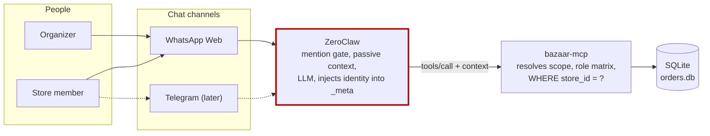
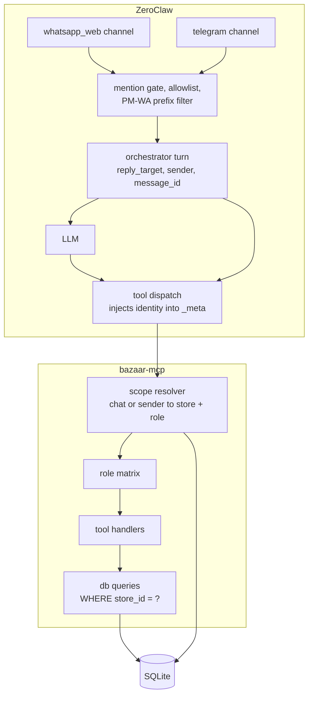
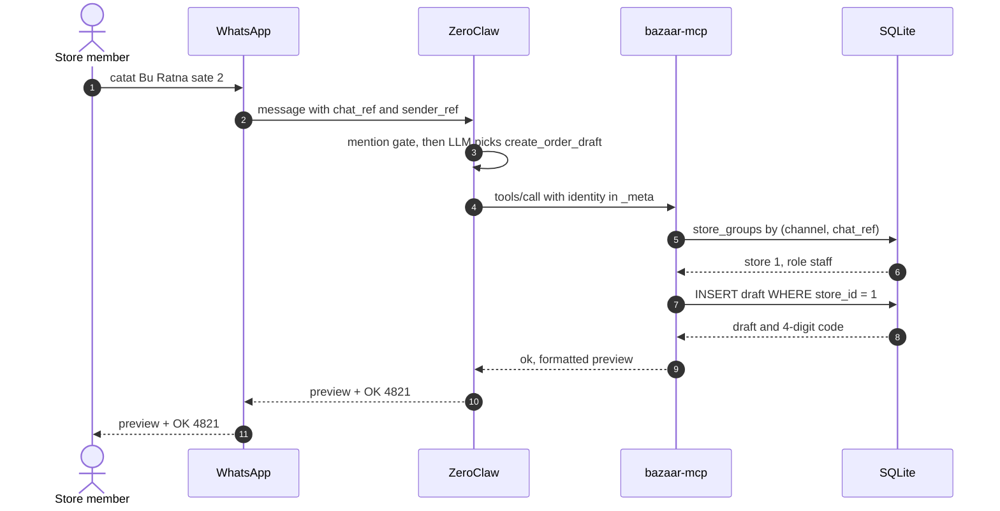

# Architecture

Status: 2026-11-21. Matches ADR 0001 to 0004 after the decision to keep ZeroClaw.

## Level 1: system context

ZeroClaw holds the channel sessions, so it is the only component that knows who
spoke. It passes that on with every tool call, and the backend refuses anything
that arrives without it.

The thick box is the trust anchor: the local parent process that spawns
`bazaar-mcp` over stdio. No network hop, no token.

## Level 2: components

## Level 3: where the pieces live

| Concern | Package | Notes |
|---|---|---|
| Channel sessions, mention gating, LLM | ZeroClaw (Rust, forked) | fork carries two patches: PM-WA filter, context injection |
| Tool-call context | `zeroclaw-tools` (`mcp_tool.rs`, `mcp_client.rs`) | `_meta` attached to the request |
| Scope resolution, role matrix | `mcpserver/` | one wrapper around `mcp.AddTool` |
| Policy, money, drafts | `orders/` | receives a `Scope` |
| SQL, store predicates | `db/` | every statement takes a store |
| User-visible text | `format/` | never receives a channel identity |

Test scenarios that drive this system over WhatsApp Web against the production
deployment: [`docs/testing/e2e-whatsapp.md`](testing/e2e-whatsapp.md).

## Request path

